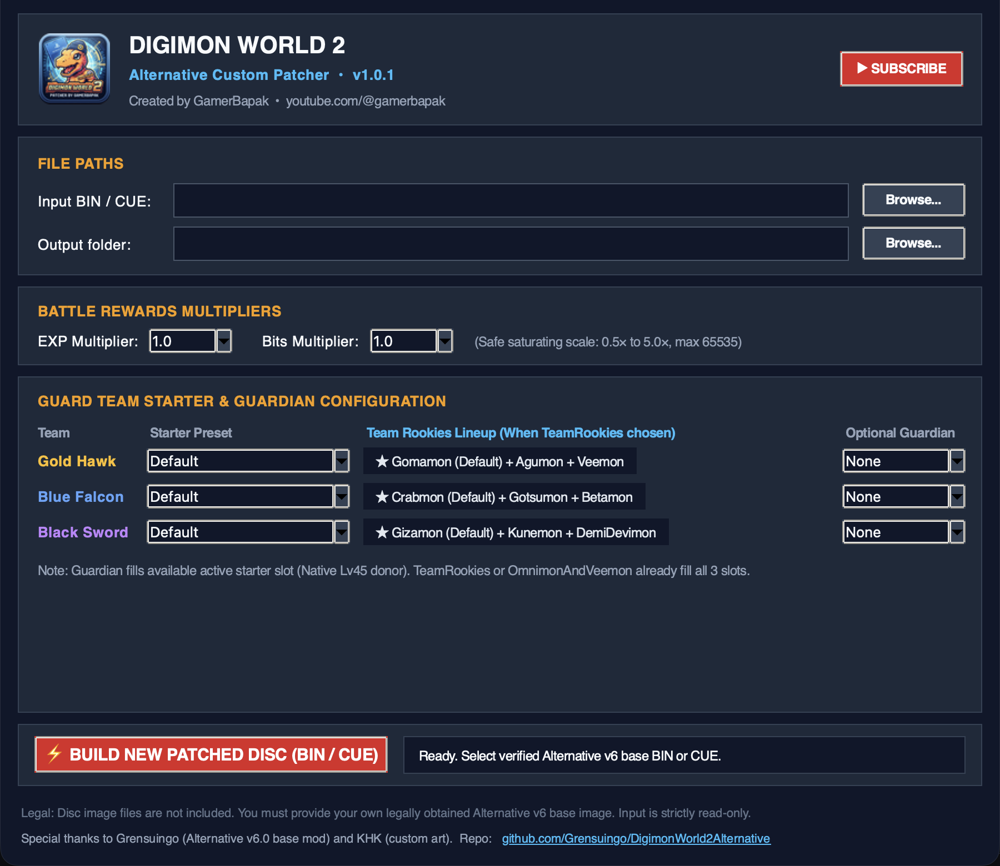

# Digimon World 2 Alternative
## GamerBapak Custom Patcher

Custom patcher for **Digimon World 2 Alternative v6**.

> Built for Alternative v6 only. Tested with Alternative v6. Vanilla Digimon World 2 and other Alternative versions are unsupported.

  

  <a href="../../releases/latest">Download v1.0.1</a>
  ·
  <a href="https://youtube.com/@gamerbapak?sub_confirmation=1">Subscribe GamerBapak</a>

---

## Downloads

| Platform | Download |
| :--- | :--- |
| Windows 10 / 11, 64-bit | [`DW2-Alternative-GamerBapak-Custom-Patcher-v1.0.1.exe`](../../releases/download/v1.0.1/DW2-Alternative-GamerBapak-Custom-Patcher-v1.0.1.exe) |
| macOS | [`DW2-Alternative-GamerBapak-Custom-Patcher-v1.0.1-macos.zip`](../../releases/download/v1.0.1/DW2-Alternative-GamerBapak-Custom-Patcher-v1.0.1-macos.zip) |

## Before You Start

This patcher extends **Digimon World 2 Alternative v6**. It does not patch vanilla Digimon World 2 directly.

1. Get your own legally obtained Digimon World 2 BIN/CUE.
2. Apply [Digimon World 2 Alternative v6](https://github.com/Grensuingo/DigimonWorld2Alternative/releases/tag/6.0).
3. Open GamerBapak Custom Patcher and select resulting Alternative v6 `.bin`.
4. Choose output location, select options, then build.

Patcher writes a separate output file. Your Alternative v6 source file stays unchanged.

## Included Customization

- Guard Team starter choices
- Team Rookies lineups
- Optional Guardian choice per Guard Team, starts at Level 1
- Input validation before build
- Separate output file protection

## What This Patcher Changes

### Guard Team starters

Choose settings independently for **Gold Hawk**, **Blue Falcon**, and **Black Sword**.

| Option | Result |
| :--- | :--- |
| `Default` | Keeps Alternative v6 starter setup unchanged. |
| `TeamRookies` | Keeps default first starter and adds two Rookie companions. |
| `Omnimon` | Keeps default first starter and adds Omnimon. |
| `Veemon` | Keeps default first starter and adds Veemon. |
| `OmnimonAndVeemon` | Keeps default first starter and adds both Omnimon and Veemon. |

### Team Rookies additions

| Guard Team | Added companions |
| :--- | :--- |
| Gold Hawk | Agumon and Veemon |
| Blue Falcon | Gotsumon and Betamon |
| Black Sword | Kunemon and DemiDevimon |

### Optional Guardian

Pick one optional Guardian for each Guard Team: **Vir**, **Dat**, or **Vac**. Guardian fills remaining starter slot. It cannot be combined with `TeamRookies` or `OmnimonAndVeemon`, because those setups already use all three starter slots.

Guardian begins at **Level 1**, matching Omnimon's level-one start. Guardian uses its native donor encounter record for starting data; only its level is changed to 1.

### Economy

EXP and Bits rewards can be configured from **0.5× through 5×**. Reward values cap at game field limit `65535`.

### Deliberately Not Included

- Chaos General option: unavailable in Alternative v6 target tables, so excluded.
- Vanilla Digimon World 2 support.
- Other Alternative versions.
- Game files, ROMs, BIOS, base images, or Alternative patch files.

## Safety and Verification

- Patcher accepts only verified Alternative v6 base BIN hash.
- Source BIN stays read-only. Patcher copies it before modifying anything.
- Output gets new `.bin`, `.cue`, and `.manifest.json` files.
- Modified Mode 2 sectors receive regenerated EDC/ECC.
- Build verifies changed-sector whitelist and output payload readback.
- Build checks pass. In-game boot, battle, save/load, and full-playthrough behavior remain **UNTESTED**.

## Credits

**GamerBapak Custom Patcher** created by [GamerBapak](https://youtube.com/@gamerbapak).

Built on [Digimon World 2 Alternative](https://github.com/Grensuingo/DigimonWorld2Alternative) v6 by [Grensuingo](https://github.com/Grensuingo).

Alternative v6 project credits:

- **Grensuingo**: project lead, ASM edits, balance decisions
- **KHK**: graphics, text-image edits, UI design, custom graphics

## Legal

No game files, ROMs, BIOS, base images, or Alternative patch assets are included. Use only legally obtained copies.

## Status

Patcher version: `v1.0.1`  
Generated mods still require in-game testing before a full playthrough.
